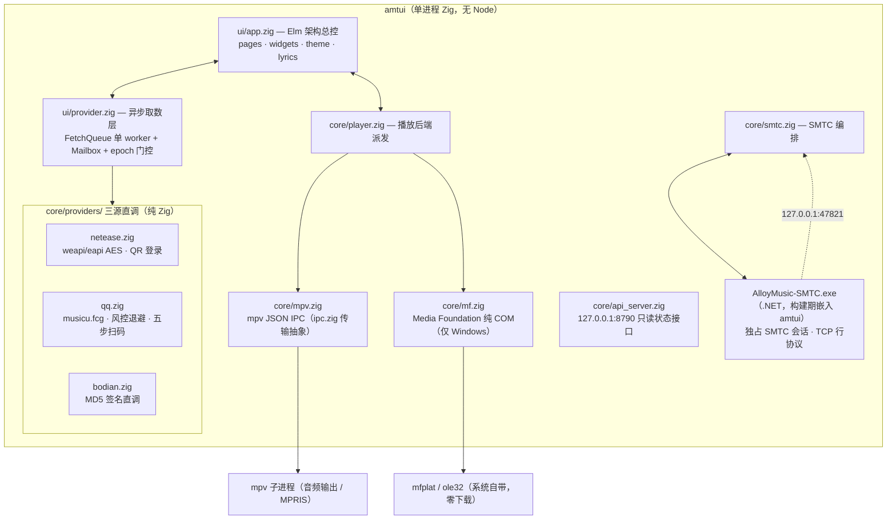

# AlloyMusic

终端里的多平台音乐播放器：**网易云音乐 / QQ 音乐 / 波点音乐** 三源切换、扫码登录、真播放（mpv / Windows 原生 Media Foundation）、滚动歌词、位图封面、系统媒体集成（SMTC）。Zig 0.17 + [zigzag](https://github.com/meszmate/zigzag)（Elm 架构 TUI 框架）实现。

## 功能

- **三音源切换**（`s` 键循环）：网易云 / QQ 音乐 / 波点，队列跨源保留（歌曲自带音源标签）
- **扫码登录**（`L` 键）：波点、网易云、QQ 三家都是纯 HTTP 扫码链路，登录态落用户数据目录，重启自动恢复
- **真播放**：双后端自动派发（`core/player.zig`）——优先 mpv 子进程（JSON IPC，全平台，播放列表预取无感衔接）；mpv 不可用时 Windows 自动降级到系统自带 Media Foundation（纯 COM 零外部二进制，`core/mf.zig`）。播放/暂停/seek/音量/自动切歌
- **歌词**：LRC 解析 + 时间轴滚动 + 网易云翻译轨合并；波点走源站解混淆链路；播放页歌词整块居中跟随
- **封面**：终端位图协议（Kitty / iTerm2 / Sixel 自动探测），进程内解码缩放出 RGB 像素（自写 JPEG/PNG 解码器），播放页大封面；不支持位图的终端（含 Windows 编译目标）不加载封面组件
- **系统媒体集成**（Windows）：SMTC 展示——Win+A / 音量面板显示曲名、歌手、专辑、封面，媒体键（播放/暂停/上一首/下一首）与面板按钮全链路可用；POSIX 上由 mpv 自带 MPRIS 承担
- **我的喜欢 / 我的歌单**：登录后侧栏显示真实歌单，我的喜欢页直接可播
- **播放模式**（`r` 键三态循环）：列表循环 / 单曲循环 / 随机（洗牌袋，不重复不漏歌）；**电台模式**（`o` 键）：三源各自的推荐流，队列快播完自动续批
- 鼠标全套：点击选歌/双击播放/滚轮翻列表/点进度条 seek/点侧栏切页/**右键菜单**（喜欢、下一首播放、追加队列）

## 架构



### 关键设计

**三源直调（`core/providers/`，纯 Zig，无 Node）**——原 Node sidecar 已完整移植进进程内（`zig-sidecar-port` 分支工作，2026-10）：

- **QQ**（`qq.zig`）：`musicu.fcg` 直连，访客态随机 qimei36 + 2001 风控退避重试（u.y/u6.y 网关轮换），迷你 cookie jar，ptlogin2 → graph OAuth → musicu 凭证的扫码五步链；PNG 二维码解码在 `core/pngqr.zig`。
- **网易云**（`netease.zig`）：weapi（双层 AES-128-CBC + RSA-None，`std.math.big.int` 手写 modpow）与 eapi（AES-128-ECB）加密链路，匿名 token 注册，cookie 注入登录态；只移植项目用到的约 15 个端点。
- **波点**（`bodian.zig`）：复用 `core/http.zig` 的 kuwotest MD5 签名直连客户端（原 bodian Zig 化雏形），补齐试听 checkRight/like/library/QR 登录。
- **封面**（`cover.zig` + `jpeg.zig`）：自写基线 JPEG 解码器 + PNG（8bit）解码，box 平均缩放；二维码编码器在 `core/qr.zig`（登录页渲染用）。
- 统一 envelope `{ok,...}|{ok:false,code,message}` 与错误码沿袭 sidecar 时代，UI 层（`ui/provider.zig`）无感知。

**provider 异步层（`ui/provider.zig`）**——zigzag 是同步 update，所有网络请求走后台线程：

- `FetchQueue` **单 worker 串行**执行（实测并发 `std.http.Client` fetch 会偶发 futex 死锁）
- `Mailbox` **多槽链表**信箱（单槽会在两次 drain 间丢后到的结果）
- 每个 `Outcome` 携带请求专属 arena 整体交接，主线程 `adoptSlot` 回收旧槽——无锁无拷贝
- `epoch` 纪元：切音源/新搜索后，在途的旧结果到达即丢弃

**mpv（`core/mpv.zig`)**——JSON IPC 全程 raw posix（io 派发的 unix connect 与并发 HTTP 组合会死锁）。spawn 后不阻塞等 socket，`tickConnect` 逐 tick 试连；请求三态（ok / mpv_err / dead），只有传输断开才算掉线并自动重连重载；属性不可用（idle 态）不当错误。IPC 传输抽象在 `core/ipc.zig`（unix socket / Windows 命名管道 comptime 选型）。

**Media Foundation（`core/mf.zig`，仅 Windows）**——mpv 不可用时的系统兜底：`MFCreateMediaSession` + 手搓 COM vtable（全部 GUID/vtable 槽位对照本机 SDK 头文件核实），worker 线程同步打开 URL（不冻结 UI），主线程每 tick 泵事件。设计/实现全过程与踩坑记录见 `docs/media-foundation-plan.md`。

**SMTC 与单文件分发（Windows）**——系统媒体集成整体放在一个 .NET 子进程（`relay/AlloyMusic-SMTC.cs`，躲开 MC.dll fire 路径的进程内 UAF，取证见 `docs/smtc.md`）。relay 不单独分发：构建期 csc 编译后以字节字面量嵌入 amtui，运行时解包到 `%TEMP%` 再 spawn（内容哈希校验，改 relay 必生效）；元数据（曲名/歌手/专辑/时间线/封面）经 TCP 行协议喂给 relay。

**Windows 渲染防御**——Windows 下 TUI 输出要过 conhost（ConPTY）这一层有状态中间层，与 WSL 直写 pty 不同，有两个结构性差异：写满最后一格立即换行（pty 是延迟换行）、对 DEC 2026 同步输出转发不完整（切页大帧被分段上屏闪帧）。对策：Windows 上全量重绘（`main.zig`，绝对寻址 + 每帧自洽）；posix 终端保留 diff 省带宽。Windows 编译目标整体移除位图封面组件（终端不支持位图协议），播放页为"顶部歌名/歌手/专辑 + 整块居中歌词"布局。

**渲染坑位备忘**：vendored zigzag 的 LayerStack 会丢行内前景色（SGR 整段替换），浮层合成在 `app.zig` 用"纯色底帧逐行拼接"绕开，**不改依赖源码**；行内样式片段结尾的 reset 会清外层 bg，需要底色的区域每个片段自带 bg。

## 快速开始

依赖：Zig 0.17；mpv 可选（Windows 上没有 mpv 时自动用系统自带 Media Foundation，其余平台 mpv 必装）。位图封面需要 Kitty / Ghostty / WezTerm / iTerm2 终端。

```bash
zig build --system zig-pkg run
```

单进程直跑（无 Node 依赖）：`zig build --system zig-pkg run` 直接启动 TUI；`zig-out/bin/` 下只有一个 `amtui` 可执行（Windows 上 relay 已内嵌其中，单文件分发）。

环境变量：`AM_BACKEND`（默认 `netease`，可选 `qq`/`bodian`/`mock`）、`AM_API_PORT`（外部接口端口，默认 `8790`，设 `0` 关闭）、`AM_CELL_RATIO`（终端字格高宽比覆盖，默认 ioctl 实测）。音源偏好持久化在 `~/.config/alloymusic/backend`。

### 数据与卸载

登录态（三源 session/cookie，0600）固定存用户数据目录，与 exe 位置无关：

- **Windows**：`%APPDATA%\AlloyMusic\auth.json`
- **Linux**：`~/.config/alloy-music/auth.json`（遵循 XDG）

卸载包管理器安装的 exe 不会动这个目录（内含登录凭证）；**彻底清除**请手动删除上述目录。

### 外部接口（歌词/状态）

TUI 启动时在 `127.0.0.1:8790` 开一个只读 HTTP 接口，供 OBS 悬浮窗、桌面组件、脚本等第三方取当前播放和歌词（只绑本机回环）：

| 端点 | 返回 |
|---|---|
| `GET /now` | JSON：`state`（playing/paused/stopped）、`seq`（换歌时 +1）、`position_ms`、`song`（元数据）、`lyrics`（带时间轴的行数组，含可选 `tr` 翻译） |
| `GET /lyrics` | 纯 LRC 文本 |
| `GET /health` | `{"ok":true}` |

没在播放时 `song`/`lyrics` 为 `null`（仍是 200），消费方轮询不用处理错误分支；当前行由消费方用 `position_ms` 在 `lines` 里二分（取 `time_ms` ≤ 進度的最后一行）。

### 键位

| 键 | 功能 | 键 | 功能 |
|---|---|---|---|
| `1-5` | 页签（探索/搜索/喜欢/队列/我的歌单） | `空格` | 播放/暂停 |
| `Tab` | 进入/离开侧栏歌单导航 | `n` / `p` | 下/上一首 |
| `↑↓ jk PgUp/PgDn` | 列表移动 | `←` `→` | ±5 秒 |
| `Enter` | 播放 / 打开歌单 | `v` | 播放界面（再按返回） |
| `a` | 追加到队列 | `/` | 搜索 |
| `s` | 切换音源 | `-` `=` `m` | 音量 / 静音 |
| `r` | 播放模式三态循环 | `L` | 登录（选音源扫码） |
| `o` | 电台模式开关 | `?` | 帮助 |
| 右键 | 歌曲菜单（喜欢/插队/追加） | `q` | 退出 |

### 各平台登录说明

- **网易云 / 波点 / QQ**：TUI 里 `L` → 数字键选平台 → 终端渲染二维码 → 手机扫码
- QQ 扫码是纯 HTTP 实现（ptlogin2 → graph.qq.com OAuth → musicu 凭证），无需手填 cookie
- 匿名也可用：搜索/探索/免费歌播放；VIP 歌取决于账号权益

## 开发

```bash
zig build --system zig-pkg test   # 单元测试（含 mock 驱动的 UI 冒烟）
zig build smoke                   # 波点后端真网络冒烟
zig build {qqsmoke,bodsmoke,netsmoke}   # 三源直调真网络冒烟（POSIX）
zig build mfsmoke                 # MF 播放后端全链路冒烟（仅 Windows，无参=内置 WAV）
zig build smtcsmoke               # SMTC 媒体键全链路（仅 Windows，SendInput 注入三键断言）
```

默认 `zig build` 产物只有发布所需的可执行（Windows 上含嵌入 relay），smoke 工具仅在对应 step 下构建安装。

- `docs/agent-handoff.md`——项目全貌分析（架构/交互/开发约定，给接手者的导读）
- `docs/smtc.md`——SMTC 中转架构技术文档（取证结论/协议/坑表）
- `snap` 截帧工具：`./zig-out/bin/amtui snap --size=110x32 --keys="1,j,enter" --out=f.ansi` 无终端驱动整帧输出，UI 回归验收用；`scratch/ansi2png.py` 可转 PNG
- `scratch/`（gitignore）——实验代码与截图工具，不入库

`ui/mock.zig` + `testdata/mock/` 是**离线测试夹具**（单元测试与 `amtui snap` 截帧工具依赖），运行时真实音源不经过它。

## 许可证

**AGPL-3.0**。本项目移植自 [bodian-music-api](https://www.npmjs.com/package/bodian-music-api)（AGPL-3.0，源自 Folia），QQ 扫码协议参考了 [HM2899/qq-music-tui](https://github.com/HM2899/qq-music-tui)（GPL-3.0，按接口协议重写，未逐行移植）。开源发布需随附源码并保留上游署名；本项目不附带任何音乐平台的官方许可，仅供学习协议实现使用。
