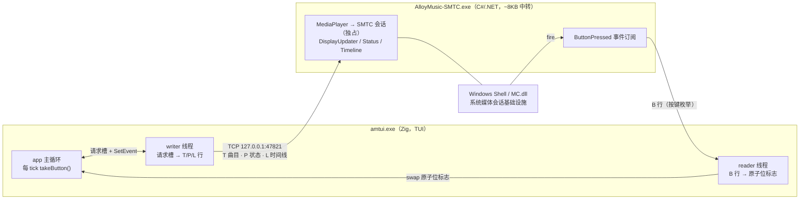
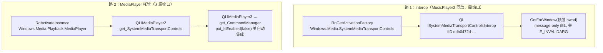
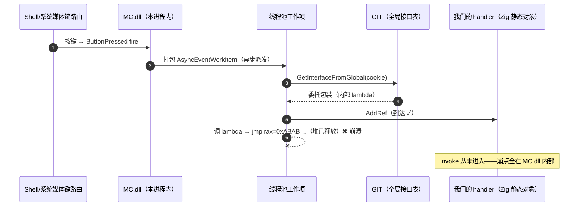
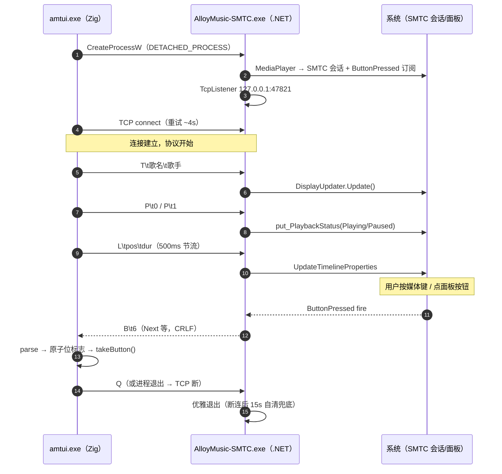
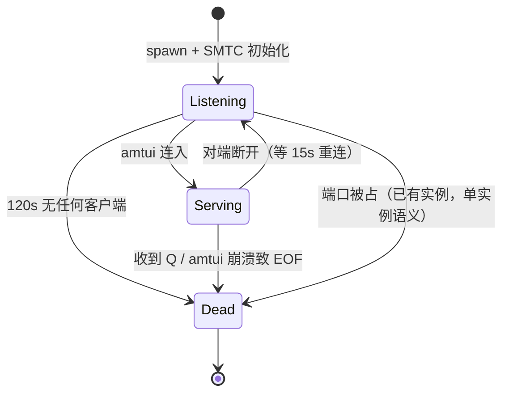
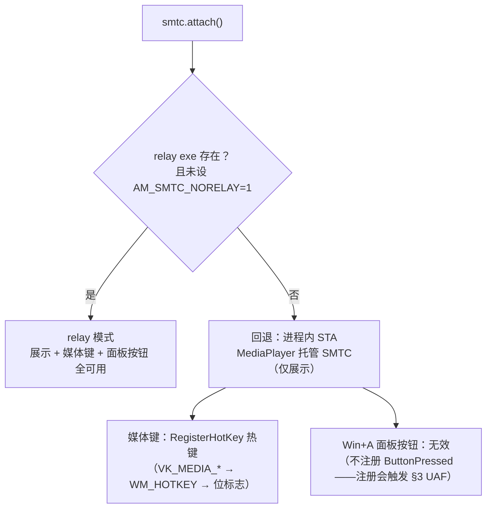

# SMTC 接入技术文档（relay 中转架构）

> 适用代码：`src/core/smtc.zig`（Zig 侧编排）+ `relay/AlloyMusic-SMTC.cs`（C# 中转进程）
> 环境基线：Windows 10.0.28120（Insider），其他版本行为可能不同
> 关联文档：`docs/media-foundation-plan.md` §10（简版）、`src/core/smtc.zig` 头注释（速查）

---

## 1. SMTC 是什么，我们的架构长什么样

SMTC（System Media Transport Controls）是 Windows 的系统媒体会话基础设施：播放器把
"我在放什么、放到哪、按钮能不能按"注册给系统，系统则把这些展示到 **Win+A 快速设置、
音量悬浮面板、锁屏、蓝牙设备**，并把用户按下的 **播放/暂停/上一首/下一首**（物理媒体键
或面板按钮）回传给播放器。



**为什么要多一个进程**：本机 Insider 版的 MC.dll（Windows.Media.MediaControl.dll，
SMTC 的进程内实现）的 ButtonPressed fire 路径有 use-after-free——**在 Zig 静态二进制
进程内注册 handler 必崩**（§3），而 MSVC/CLR 进程（MusicPlayer2、.NET 程序）不触发。
把 SMTC 整体挪进 .NET 子进程是实测唯一能同时保住「展示 + 媒体键 + 面板按钮」的方案。

---

## 2. 术语词典（逐个解释取证报告里的变量）

下面按「变量 × 组合」的原始措辞逐项解释。每一条都是当时可以独立拨动的开关，
穷举它们的组合是为了证明崩溃与我们的实现无关。

### 2.1 handler 形态（ButtonPressed 事件委托怎么实现）

**handler / delegate**：SMTC 的 `add_ButtonPressed(handler, &token)` 要求传入一个实现
COM 接口 `ITypedEventHandler<SystemMediaTransportControls, ButtonPressedEventArgs>`
的对象（vtable = IUnknown 3 槽 + IInspectable 3 槽 + Invoke 1 槽）。按键触发时 MC.dll
回调它的 `Invoke(sender, args)`。Zig 没有运行时，这个对象要手搓 vtable——"形态"指
这个手搓对象对外呈现哪些 COM 特性：

| 形态 | QI 表现 | fire 时怎么被调 | 谁在用 |
|---|---|---|---|
| agile + FTM | 承认 `IID_IAgileObject`，`IMarshal` 转发进程级 FTM | 任意线程裸调 Invoke，零编组 | 我们默认；Chromium 式 |
| 非 agile（plain） | 只认 IUnknown/IInspectable/事件接口 | COM 编组回 handler 所在 STA，**该线程必须泵消息** | MusicPlayer2 的 `WRL::Callback<>` |
| +IWeakReferenceSource | 额外承认弱引用源（WRL 对象自带） | 同上，注册路径可能 QI 它 | WRL RuntimeClass 默认 |
| getIids 实值 vs 空表 | `GetIids` 返回真实 IID 列表 vs count=0 | fire 路径可能读 | 我们两种都试过 |

- **agile（敏捷对象）**：普通 WinRT 对象绑定在创建它的套间（见 2.4）里，别的线程调它要
  经 COM 编组代理；agile 对象则承诺"任何线程直接调都安全"。实现方式是 QueryInterface
  时额外承认 `IID_IAgileObject`，并把 `IMarshal` 转发给一个自由线程列集器。agile 的
  好处：fire 线程可以裸调 Invoke，不需要我们的线程泵消息。
- **FTM（Free-Threaded Marshaler，`CoCreateFreeThreadedMarshaler`）**：Windows 自带的
  万能 IMarshal 实现——同进程内编组时直接传裸指针（零开销），跨进程才真正列集。
  「agile/FTM 形态」= QI(IAgileObject) 自指 + QI(IMarshal) 转发进程级 FTM。
- **非 agile**：什么都不答（只认 IUnknown/IInspectable/事件接口本身）。fire 时 COM 会
  把调用编组回 handler 所在的 STA，需要 STA 泵消息才能送达。MusicPlayer2 的
  `WRL::Callback<>` 默认就是这个形态。
- **补弱引用（IWeakReferenceSource/IWeakReference）**：WRL 生成的对象默认还实现"弱
  引用源"接口（别人可以拿一个不阻止析构的引用）。MC.dll 的事件机制注册时可能 QI 它；
  我们的手搓对象最初不承认 → 补了一个 Resolve 回强引用的静态实现。
- **getIids 实值**：IInspectable 契约要求 `GetIids` 返回"本对象实现了哪些接口"的 IID
  列表。偷懒返回 count=0 也合法，但 MC.dll 的 fire 路径可能读它——"实值"指老老实实
  返回 `[ITypedEventHandler]`（CoTaskMemAlloc 分配）而不是空列表。

### 2.2 初始化顺序（MusicPlayer2 配方）

SMTC 会话的一串设置调用顺序可能影响 MC.dll 内部状态机：

- **默认顺序（我们最初的）**：`put_IsEnabled(true)` → 各按钮使能 → `put_PlaybackStatus`
  → DisplayUpdater 元数据 → **最后** `add_ButtonPressed`。
- **MusicPlayer2 配方**：`put_PlaybackStatus(Closed)` → DisplayUpdater →
  **先** `add_ButtonPressed` → 各按钮使能（含 `put_IsStopEnabled`）→ **最后**
  `put_IsEnabled(true)`。理由是"handler 就位后再打开开关"，避免开关打开瞬间的事件
  打在未注册的空 handler 上。

两种顺序在本机都崩（§3），排除该变量。

### 2.3 获取路径（SMTC 实例从哪来）

Windows 给桌面程序两条路拿 `SystemMediaTransportControls` 实例：



- **interop GetForWindow**（MusicPlayer2 的路）：会话锚定在一个顶层窗口上，UWP 等价物
  是 `GetForCurrentView()`。
- **MediaPlayer 托管**：会话由媒体引擎托管，不需要窗口。

两条路在本机都崩，排除该变量。最终回退路径（relay 缺失时）用 MediaPlayer 托管做展示。

### 2.4 套间（apartment：STA / MTA / 纯 CoInitializeEx）

COM 的线程模型。**套间**是一栋"对象公寓"：决定跨线程调用怎么被派发。

- **STA（单线程套间，`CoInitializeEx(null, COINIT_APARTMENTTHREADED)` / `RoInitialize
  (RO_INIT_SINGLETHREADED)`）**：一个线程独栋。对象只被创建线程触碰；别的线程调它，
  COM 把调用变成一条消息投到该线程的隐藏窗口，**该线程必须泵消息**（GetMessage/
  DispatchMessage）调用才会被执行。窗口过程天然串行化，适合有 UI 的对象。
- **MTA（多线程套间，`COINIT_MULTITHREADED` / `RO_INIT_MULTITHREADED`）**：整栋大楼
  共享。任何线程都能直接调对象（要求对象自己线程安全），无消息泵依赖。
- **纯 CoInitializeEx vs RoInitialize**：`RoInitialize` ≈ `CoInitializeEx` + WinRT 上下文
  标记。微软文档说桌面程序两者皆可，但早期取证怀疑「进程内首个 COM 初始化必须是
  RoInitialize，否则 WinRT 参数化类型机器半初始化」——本机实测（MusicPlayer2 是 MFC
  纯 CoInitializeEx(STA) 起家，照样能用 SMTC）证伪了强依赖，但作为变量保留在矩阵里。

我们的组合试过：SMTC 放专用 STA 线程（主线程 MTA + STA 混合）、整个 SMTC 线程跑
MTA、进程内只有单 STA 且用纯 CoInitializeEx——全部崩溃，排除该变量。

### 2.5 进程形态（带 MF / 最小单 STA）

- **带 MF 的完整形态**：amtui 的真实环境——主线程先 `MFStartup`（Media Foundation，
  音频输出，基于 COM/MTA），SMTC 在专用 STA 线程。怀疑点：MF 的 MTA 污染进程级
  COM 状态。
- **最小单 STA（AM_SMTC_MIN=1 冒烟模式）**：进程里除 SMTC 外**零 COM 活动**——不碰
  MF、不碰网络，只有一条 STA 线程做 GetForWindow/MediaPlayer + SendInput 注入验证。
  这是能构造的最接近 MusicPlayer2 的进程形态。

最小形态也崩，排除"进程内其他组件污染"的假设。

### 2.6 稀疏 MSIX 包身份（package identity）

**包身份** = Windows 给进程挂一个 MSIX 包名（`GetPackageFullName` 能查到）。UWP/商店
应用天生有；传统 Win32 程序没有。很多系统功能（通知、分享目标、部分激活路径）点名
要它。**稀疏包（packaging with external location）**＝不真正打包文件，只注册一份清单
把身份"贴"在现有 exe 上：

1. `AppxManifest.xml`：`<Identity>` + `<Properties><uap10:AllowExternalContent>true>` +
   `<Application uap10:TrustLevel="mediumIL" uap10:RuntimeBehavior="win32App">`（微信
   WeixinShare 同款形态）+ `<rescap:Capability Name="runFullTrust"/>`。
2. **exe 必须内嵌 fusion manifest 的 `<msix>` 元素**（`assets/smtc_identity.manifest`，
   packageName/publisher/applicationId 与包清单一致）——**没有它，注册再成功进程也拿
   不到身份**，`GetPackageFullName` 报 `0x80073D54`（微软文档 Troubleshooting 表原话
   症状）。zig 侧用 `exe.win32_manifest` 挂载。
3. 开发者模式下注册：
   `Add-AppxPackage -Register <repo>\AppxManifest.xml -ExternalLocation <repo>\zig-out\bin`；
   卸载：`Get-AppxPackage AlloyMusic.SmtcIdentity | Remove-AppxPackage`。

身份打通后崩溃依旧——**包身份不是崩溃判别变量**。relay 落地后整条链失去作用场景
（SMTC 卡片归属 relay 进程，amtui 的包身份不影响面板显示），且稀疏包从未保持注册；
2026-11-01 资产已删除（`AppxManifest.xml`、`assets/`、build.zig 的 win32_manifest 挂载）。
本节留作机制记录；若将来要面板显示真实应用名，正路是给 relay 进程做身份/快捷方式
（MusicPlayer2 的 .lnk 方案，§5）。

### 2.7 崩溃侧术语

- **MC.dll**：`Windows.Media.MediaControl.dll`，SMTC 的进程内 WinRT 实现（GetForWindow
  拿到的对象的真身、ButtonPressed 事件的 fire 引擎）。
- **fire**：事件触发动作——按键到达时 MC.dll 遍历已注册委托逐个调 Invoke 的过程。
- **GIT（Global Interface Table，`IGlobalInterfaceTable`）**：进程级"接口寄存处"，把一
  个 COM 对象注册成 32 位 cookie，任何线程凭 cookie 取回可用的接口指针。符号化栈显示
  MC.dll 用 `Windows::Internal::GitInvokeHelper` + `GitPtrSupportsAgile` 经 GIT 存取
  handler（所以当时做过 GIT 直接探针：在本进程注册/取回我们的 handler 是 S_OK 的，
  GIT 本身没坏）。
- **EventInvocationContext / AsyncEventWorkItem / InvokeModeOptions**：MC.dll 内部的
  异步事件派发设施——fire 不在触发线程同步调 handler，而是打包成线程池工作项异步执行。
- **freed fill 0xAB**：Windows NT 堆把已释放块填充为 0xAB。崩溃现场 `jmp rax` 且
  `rax=0xABABABABABABABAB`＝调用了"堆上已被释放对象"的虚函数——**这是 MC.dll 自身
  对象的 use-after-free**（不是 Zig 的内存：Zig 分配器不用 0xAB 填充，我们的 handler
  是静态存储期也根本不释放）。

---

## 3. 取证结论：为什么进程内方案全灭

用 smtcsmoke（SendInput 注入真实媒体键）+ 自制调试 harness（ctypes 调试循环接住 AV、
读子进程内存、dbghelp + 微软符号服务器手动下载 PDB 符号化）拿到崩溃栈：



<details>
<summary>原始符号化崩溃栈（点开查看）</summary>

```
AV at RIP=MC.dll+0x8f0c0（jmp rax，rax=0xABABABABABABABAB）
  ComPtr<IAsyncOperation<unsigned int>>::InternalRelease
  GitInvokeHelper<ITypedEventHandler<SMTC,ButtonPressedEventArgs>, …>::Invoke
  WRL InvokeTraits::InvokeDelegates
  AsyncEventSourceT::AsyncEventWorkItem::~AsyncEventWorkItem
  EventInvocationContext<0>::AsyncEventWorkCallback   ← 线程池异步 fire
```

</details>

含义：fire 被打包成异步工作项 → 经 GIT 取回委托包装 → **调用的 lambda 所在堆块已被
释放** → 崩溃。我们的 handler 只有 AddRef/Release 到达，**Invoke 从未进入**。

变量矩阵（§2 全部条目 × 彼此组合）**全部复现崩溃**。三个关键旁证：

> **2026-11-01 复验补充**：用户怀疑"Zig 没走 MSVC 工具链"是崩溃原因。实测
> `zig build smtcsmoke -Dtarget=x86_64-windows-msvc`（本机 VS 18 + SDK 26100，zig 0.17
> 自动检测 link.exe）后矩阵复跑：**工具链无关**——msvc 与 mingw 构建同样「MF 完整形态
> + BTNEVENTS 必崩（同一条 MC.dll fire 栈）、MIN 模式 PASS」。且 **MIN 模式（无 MF 单
> STA）如今两个工具链都 PASS**（当初记录为必崩）——系统侧状态已变（疑似 Insider 更新
> 修掉了无 MF 路径的 UAF），剩余判别变量被收窄为 **MF/MTA 的存在**。当时"MSVC/CLR 进程
> 不触发"的旁证 2 实为 CLR 程序无 MF 的 MTA 污染，变量认错。追加实验开关（env 门控，
> 无副作用）：`AM_SMTC_PREINIT=1`（SMTC attach 提前到 MFStartup 之前，mf.zig）、
> `AM_SMTC_MTA=1`（SMTC 线程跑 MTA 而非 STA，smtc.zig staMain）。两者及其组合在 MF
> 形态下仍崩，方向 1/2 已排除；再攻此题应优先考虑「SMTC 与 MF 不同进程」（即 relay）
> 或等系统更新修复完整形态路径。

1. **MusicPlayer2 实测可用**：同一台机器、同样的 SendInput 注入，其会话状态随按键在
   Paused/Playing 之间切换（用 GSMTC API 观测，见 §6）。
2. **.NET 探针实测可用**：csc 编译的 MediaPlayer + ButtonPressed 订阅，五连发全收、
   进程健在——**MSVC/CLR 运行时的进程不触发此 UAF，Zig 静态二进制触发**，残余差异
   （CLR 的对象布局/堆行为/CCW 包装细节）无法进一步定位。
3. **GSMTC 客户端 API 没有 ButtonPressed 事件**（只有元数据/状态/时间线变更通知），
   "客户端旁路监听自己会话"这条路不存在。

注册 handler 的后果是**用户点一下 Win+A 播放按钮就杀掉整个播放器**——relay 方案之前的
过渡期因此默认不注册（`AM_SMTC_BTNEVENTS=1` 保留为实验开关）。

---

## 4. 最终架构：relay 中转

### 4.1 组成与协议

- `relay/AlloyMusic-SMTC.cs`：.NET Framework 4.x 控制台程序，**csc 编译零依赖**
  （Windows 10/11 自带 .NET 4.x）。**2026-11-01 起单文件分发**：build.zig 在配置期
  同步跑 csc（`/optimize+` 即 release），产物字节生成为 `src/core/relay_embed.zig`
  字面量嵌入 amtui；amtui 启动时同目录无 relay exe 则解包到 `%TEMP%\AlloyMusic-SMTC.exe`
  再 spawn（同目录有则优先用，开发可手放覆盖）。手动编译：`relay/build_relay.bat`。
- 协议（TCP `127.0.0.1:47821`，行式 UTF-8，LF 结尾）：
  - amtui → relay：`T\t<title>\t<artist>\t<album>`（曲目；第 4 段专辑，缺段兼容旧版）、
    `C\t<cover_url>`（封面 URL，relay 下载到 %TEMP%（MD5 缓存）挂
    `RandomAccessStreamReference.CreateFromUri(file://…)`——本地 file URI 而非
    StorageFile（csc winmd 投影缺聚合引用）；**收 T 先清旧封面再等 C**，无封面歌
    天然不残留）、`P\t<0|1>`（状态）、`L\t<pos_ms>\t<dur_ms>`（时间线）、`Q`（退出）。
  - relay → amtui：`B\t<n>`，n 为 .NET 投影枚举
    `SystemMediaTransportControlsButton`：Play=0 Pause=1 Stop=2 Record=3
    FastForward=4 Rewind=5 **Next=6 Previous=7**（注意与旧记忆的 3/4 不同）。
    Zig 侧映射 0/1→play_pause、6→next、7→prev，写进与热键共用的原子位标志。
- 生命周期：端口被占＝已有实例（amtui 直接连旧实例）；断连后 15s 无新连接自杀；
  收 `Q` 立即退；amtui 崩溃时 TCP 断 → 自清。
- 控制台隔离：`DETACHED_PROCESS`（0x8）spawn——**不继承 TUI 的控制台**。.NET 运行时
  偶发往控制台写（异常文本是 UTF-16 流）会直接打花 TUI 终端（用户观测到的二进制
  乱码即此）；relay 的诊断走自己的文件日志 `relay_log.txt`（`Log()`，排障用，正式版可删）。

完整一次会话的消息流：



relay 进程生命周期：



### 4.2 已知的坑（都踩过）

| 坑 | 症状 | 规避 |
|---|---|---|
| relay `WriteLine` 是 CRLF | 按键事件全丢（`parseInt("1\r")` 失败） | Zig 解析前 `std.mem.trim(u8, l, " \r")` |
| 按键枚举值 | next/prev 映射反了 | 以 .NET 投影为准（6/7），勿凭 winmd 记忆 |
| 匿名管道传输 | 子进程写成功、父端 ReadFile 永远收不到（未解） | 改用 TCP loopback |
| 控制台继承 | .NET 偶发往父控制台写 UTF-16 → TUI 终端二进制乱码 | `DETACHED_PROCESS` spawn |
| 锁屏 | SendInput 注入的键**不触发 WM_HOTKEY**（F9 对照实验证实），但 SMTC fire 照常路由 | 热键路径断言须解锁后跑；relay 路径锁屏也有效 |
| **Thumbnail 三连坑（2026-11-01 实测，此 Insider 版）** | `CreateFromUri(file://)` 不加载；`CreateFromStream(内存流)` 挂载成功无异常但面板不消费；面板忽略 Thumbnail 的另一路径是 DisplayUpdater 实例的 `Type` 回到 Unknown | **只有 `CreateFromFile(StorageFile)` 这条 shell 肯消费**；挂 Thumbnail 前必须重设 `du.Type=Music`；同时 relay 的 `MediaPlayer.CommandManager.IsEnabled=false`（否则自动集成用空 updater 打 Update 抹掉元数据）。编译需 UnionMetadata 的 Windows.winmd **聚合引用**——System32 单个 winmd 与 AsRandomAccessStream 的 facade 类型冲突（CS1503），与聚合并用又冲突（CS0433），只能全用聚合 |
| csc 选项前缀 | 源文件路径 `relay/xxx.cs` 的 `/` 被 csc 当选项前缀吃掉（CS2001 找不到文件） | 源文件/输出路径用反斜杠 |
| message-only 窗口 | interop GetForWindow 返回 E_INVALIDARG | 必须顶层窗口（回退路径用） |
| `MESessionEnded` 后不 Stop | 时钟停旧曲末尾，下一首 `Start(VT_EMPTY)` 从旧位置续播——进度残留/短歌连跳/seek 失效（2026-10-30 用户报告的进度条 bug） | mark_eof 时 `session.Stop()`（mf.zig pumpEvents，MF Playback 样例同款） |

### 4.3 回退路径（relay 不可用时）

attach 时的模式决策：



`AM_SMTC_NORELAY=1` 或找不到 `AlloyMusic-SMTC.exe` 时，走进程内 STA：
MediaPlayer 托管 SMTC（仅展示）+ `RegisterHotKey` 热键媒体键（VK_MEDIA_*，MOD_NOREPEAT，
WM_HOTKEY → 位标志）。此时 Win+A 按钮无效（不注册 ButtonPressed），键盘/耳机媒体键
不受影响。注意此路径的优缺点：热键是全局捕获（本应用存活期间媒体键归本应用，不转发），
relay 路径则把按键还给系统路由（没有播放时其他播放器照常响应）。

---

## 5. MusicPlayer2 是怎么做的（以及为什么它没有 .cs 文件）

**直接回答：MusicPlayer2 是 C++ 项目，不是 C#。** 它的 SMTC 实现用 C++/WRL 写在
`MusicPlayer2/MediaTransControlsImpl.{h,cpp}`（`#include <windows.media.h>` SDK ABI 头 +
`Microsoft::WRL::Callback<>` + `#pragma comment(lib, "RuntimeObject.lib")`），所以仓库里
既没有 .cs 也不依赖 .NET。上次抓取的源码要点（可作对照实现）：

- **pImpl 双层封装**：外层 `MediaTransControls` 是纯 C++ 接口类（`CPlayer` 直接持有成员），
  内层 `MediaTransControlsImpl` 在 cpp 里 include SDK 头真正调 WinRT——业务层完全不
  接触 WinRT 类型。这个思路与我们的"SMTC 全部细节关在 smtc.zig/relay 里"同构。
- **获取路径**：`ISystemMediaTransportControlsInterop::GetForWindow(主窗口 HWND)`（§2.3），
  外层把 `AfxGetMainWnd()->GetSafeHwnd()` 传进 Impl 构造。
- **handler 形态**：`WRL::Callback<ITypedEventHandler<SMTC*, ButtonPressedEventArgs*>>`
  ——**非 agile**（§2.1），注册在 MFC 主线程（STA + 全天候消息泵）。这正是我们矩阵里
  "plain handler" 的形态，在 Zig 进程里崩、在它进程里能用。
- **初始化顺序**（§2.2 的"配方"来源）：`put_PlaybackStatus(Closed)` → DisplayUpdater →
  `add_ButtonPressed` → 各按钮使能（含 Stop）→ `put_IsEnabled(true)` 收尾。
- **事件转窗口消息**：按钮回调不直接碰播放逻辑，而是
  `SendMessage(主窗口, WM_COMMAND, ID_PLAY/ID_PAUSE/…)`，复用现有菜单命令处理；
  seek 回调 `PlaybackPositionChangeRequested` 用 `try_lock_for(1s)` 保护
  `CPlayer::SeekTo(毫秒)`（注意它拿到的位置单位是 **100ns，要 /10000 转毫秒**）；
  倍速回调直接调 `SetSpeed`。
- **状态同步四件套**：`UpdateControls(status)` / `UpdateControlsMetadata(song)` /
  `UpdatePosition(ms, force)`（带限流）/ `loadThumbnail`（封面三来源：本地文件、
  `http(s)://` URL、内存 buffer——对应 `RandomAccessStreamReference::CreateFromFile/
  Uri/Stream`，我们 v1 没做封面，这条是现成的扩展路径）。
- **Win11 显示名**：启动时在开始菜单 Programs 目录建 `MusicPlayer2.lnk`
  （`QueryFullProcessImageName` 拿物理路径，避免 scoop junction 假路径），否则面板显示
  "未知应用"。这与包身份是两套机制：快捷方式只管显示，不授予身份。
- **降级链**：Win8.1 以下无 SMTC → 用 `WH_KEYBOARD_LL` 低级键盘钩子拦 `VK_MEDIA_*`
  转 `WM_COMMAND`，且钩子仅在 `!IsWindows81OrLater() && !m_controls.IsActive()` 时挂；
  编译期 `DISABLE_MEDIA_TRANS_CONTROLS` 宏可整体桩化（解决 Win7 缺
  api-ms-win-*.dll）。我们的回退路径（RegisterHotKey）与之同思路——RegisterHotKey 更
  简单（无需钩子 DLL 注入语义），代价是进程存活期间媒体键被全局占用。

**为什么它不需要 relay 而我们需要**：它整个进程跑在 MSVC CRT 上，WRL 对象的分配/布局
与 MC.dll 的配合恰好不踩这个 Insider 版的 UAF；Zig 静态二进制的堆/对象形态踩了。这不是
"MusicPlayer2 写得对、我们写得错"——同一份 handler 逻辑换个运行时就有相反结局，属于
系统侧缺陷（也可能在后续 Insider 版被修掉，届时 `AM_SMTC_BTNEVENTS=1` +
`AM_SMTC_NO_HOTKEY=1` 跑 smtcsmoke 一验便知，能过就可以简化掉 relay）。

---

## 6. 观测与回归工具

- **`zig build smtcsmoke`**：SendInput 注入三键，断言 play_pause/next/prev 经
  系统→fire→relay→TCP→位标志全链路到达（relay 模式锁屏也有效）。
- **`zig build mfsmoke`**：MF 后端全链路（打开/时长/推进/暂停/seek/resume/EOF/换曲），
  含"EOF 换曲后位置必须归零"回归断言（§4.2 最后一行的 bug 由它看门）。
- **GSMTC 无头观测**（PowerShell，从外部看系统里所有媒体会话，验证"是否真的路由到了"）：

```powershell
Add-Type -AssemblyName System.Runtime.WindowsRuntime
$null = [Windows.Media.Control.GlobalSystemMediaTransportControlsSessionManager, Windows.Media.Control, ContentType = WindowsRuntime]
$op = [Windows.Media.Control.GlobalSystemMediaTransportControlsSessionManager]::RequestAsync()
$m = ([System.WindowsRuntimeSystemExtensions].GetMethods() | Where-Object { $_.Name -eq 'AsTask' -and $_.GetParameters().Count -eq 1 -and $_.GetParameters()[0].ParameterType.Name -eq 'IAsyncOperation`1' })[0]
$task = $m.MakeGenericMethod([Windows.Media.Control.GlobalSystemMediaTransportControlsSessionManager]).Invoke($null, @($op))
if ($task.Wait(8000)) { $task.Result.GetSessions() | ForEach-Object {
  Write-Output ("[" + $_.SourceAppUserModelId + "] " + $_.GetPlaybackInfo().PlaybackStatus) } }
```

- **relay 日志**：`relay_log.txt`（中转进程生命周期/BTN/异常，`Log()` 排障用）。
- **环境开关**：`AM_SMTC_NORELAY=1`（强制回退）、`AM_SMTC_NO_HOTKEY=1`（关热键，让键进
  SMTC 路由）、`AM_SMTC_BTNEVENTS=1`（回退路径强制注册 handler，实验用）、
  `AM_SMTC_MIN=1`（无 MF 单 STA 最小复现）。

---

## 7. WSL 场景（实测结论）

在 WSL 终端里跑 AlloyMusic 时的现象与原理（本机 WSL2 Arch 实测）：

1. **跑的是哪个二进制**：WSL interop 是开的（`/proc/sys/fs/binfmt_misc/WSLInterop`
   = enabled，`cmd.exe /c ver` 正常返回）——`./amtui.exe` 会被 binfmt 交给 Windows，
   作为**原生 Windows 进程**启动。所以 COM/MF 音频输出是真的 Windows 音频（"还在用
   COM"的观察正确）；Linux 构建在 posix 上只有 mpv 一条音频路（player.zig 编译期
   定死，无运行时降级），没装 mpv 就只能"假进度"无声。
2. **SMTC 显示但控制不了（旧构建）**：relay 方案落地前的构建只有"进程内展示 +
   RegisterHotKey 热键"——面板卡片来自 MediaPlayer 托管的展示会话，但 ButtonPressed
   handler 因 MC.dll UAF（§3）不注册，Win+A 按钮天然无效。这与运行环境无关，Windows
   侧旧构建同样如此。
3. **当前 relay 构建实测全通**：从 WSL bash 启动 `amtui-smtcsmoke.exe`，三键断言
   PASS（play_pause/next/prev 经 interop→Windows 进程→MF→relay→SMTC→fire→TCP 回环
   全链路）。原因：interop 启动的 exe 就是真正的 Windows 进程，TCP loopback、
   CreateProcess、SMTC 全部在 Windows 侧闭环，WSL 只是提供了终端 pty。

注意两点：
- WSL2 的 `127.0.0.1` 是 WSL 自己的命名空间，与 Windows 的 loopback 不互通——若将来
  让 **Linux 构建**也接 relay，需连 Windows 宿主 IP 而非 127.0.0.1（且 Linux 构建目前
  压根没有 relay 代码，mpv 自带 MPRIS 系统集成，不需要 SMTC）。
- 若 SMTC 卡片出现但 `tasklist | findstr AlloyMusic` 查无 amtui：那是 Windows 侧残留
  的 relay 进程（断连后 15s 自清），其会话的对端已死，控制不了属预期。
